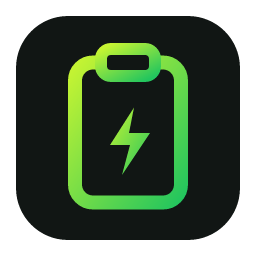
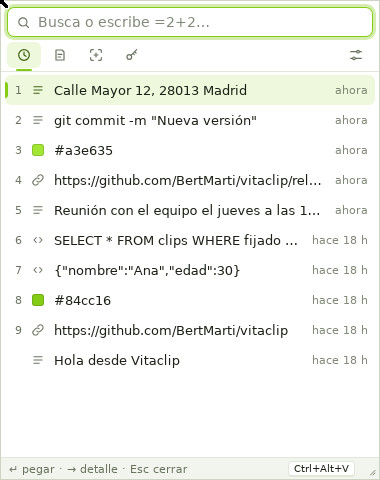
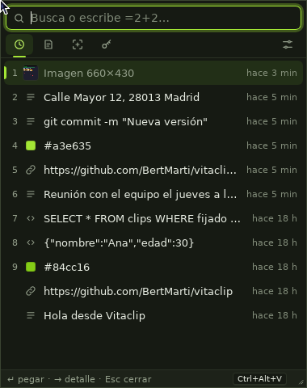
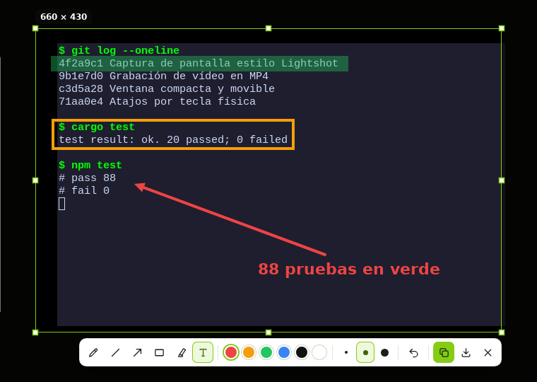

<div align="center">



# Vitaclip

**El portapapeles supervitaminado.**<br>
Historial de todo lo que copias, capturas de pantalla con anotaciones y grabación de vídeo, a un atajo de distancia.

[](https://github.com/BertMarti/vitaclip/releases/latest)
[](https://github.com/BertMarti/vitaclip/actions/workflows/ci.yml)
[](LICENSE)


Gratis y de código abierto · Sin cuentas ni anuncios · Todo se queda en tu equipo


&nbsp;&nbsp;


</div>

---

## ¿Qué es?

Vitaclip junta en una sola ventanita tres cosas que usas cada día:

- **Lo que hace Ditto:** guarda todo lo que copias (textos e imágenes). Pulsas tu atajo, escribes para buscar y con `Enter` se pega donde estabas.
- **Lo que hace Lightshot:** eliges una zona de la pantalla, la anotas con flechas, recuadros, marcador o texto, y la copias o la guardas.
- **Un grabador de pantalla:** grabas una zona o la pantalla completa en MP4 de alta calidad, en la carpeta que elijas.

La ventana es pequeña, sale junto al ratón y se puede mover y redimensionar. No estorba.

## Descargar

**👉 [Última versión](https://github.com/BertMarti/vitaclip/releases/latest)**

| Sistema | Archivo |
|---|---|
| Windows 10/11 | `Vitaclip_x.y.z_x64-setup.exe` (o `.msi`) |
| macOS con chip Apple (M1, M2…) | `Vitaclip_x.y.z_aarch64.dmg` |
| macOS Intel | `Vitaclip_x.y.z_x64.dmg` |
| Linux x64 | `.deb`, `.rpm` o `.AppImage` (`amd64` / `x86_64`) |
| Linux ARM64 (Raspberry Pi 5…) | `.deb`, `.rpm` o `.AppImage` (`arm64` / `aarch64`) |

La app no está firmada (los certificados de Apple y Microsoft son de pago), así que la primera vez el sistema avisa.
Cómo abrirla igualmente y qué permisos dar: **[guía de instalación](docs/INSTALACION.md)**.

## Empieza en 30 segundos

1. Abre Vitaclip. La primera vez verás los ajustes: **graba tus atajos** pulsando la combinación que quieras.
2. Copia cosas como siempre. Vitaclip las guarda en segundo plano (vive junto al reloj, en la bandeja del sistema).
3. Pulsa tu atajo, escribe para buscar y pulsa `Enter`. Ya está pegado.

| Atajo (sugerencia, cámbialo a tu gusto) | Qué hace |
|---|---|
| `Ctrl+Alt+V` | Abre el historial |
| `Ctrl+Alt+C` | Captura una zona de la pantalla |
| `Ctrl+Alt+R` | Empieza o termina una grabación de vídeo |

En Mac son `⌘⌥V`, `⌘⌥C` y `⌘⌥R`. Funcionan con cualquier distribución de teclado (también con la Ñ en Windows).

## Capturas de pantalla, como Lightshot



Arrastra para elegir la zona y anótala: **lápiz, línea, flecha, rectángulo, marcador y texto**, con 6 colores y 3 grosores.

| Tecla | Acción |
|---|---|
| `Enter` o `Ctrl+C` | Copiar (y queda también en tu historial) |
| `Ctrl+S` | Guardar como PNG en `Imágenes/Vitaclip` (o tu carpeta) |
| `Ctrl+Z` | Deshacer |
| Flechas (`Shift` = 10 px) | Mover la zona |
| `Esc` | Salir |

## Grabación de vídeo


Pulsa el atajo de vídeo, elige una zona (`Enter`) o la pantalla completa (`F`) y graba. Un indicador discreto muestra el tiempo; para
terminar, pulsa **Detener** o el mismo atajo.

- **MP4 H.264** a la resolución nativa de tu pantalla, a **30 o 60 fps**, con calidad **Alta** o **Máxima**.
- Se guarda en `Vídeos/Vitaclip` o en la carpeta que elijas en **Ajustes → Capturas y vídeo**.
- En Windows y Mac el indicador no sale en el vídeo.
- De momento graba **sin sonido**.

## Todo lo que trae

- **Historial** de textos e imágenes con búsqueda instantánea (`img:`, `url:`, `fij:`), fijados y pegado con `Enter` o `Ctrl+1…9`.
- **Detalle** de cada elemento con contadores, código QR y colores (HEX, RGB, HSL).
- **22 transformaciones de texto:** MAYÚSCULAS, Tipo Título, camelCase, snake_case, JSON bonito, Base64, URL, quitar tildes, ordenar líneas…
- **Calculadora** en el buscador: `=21*1,21` → `25,41`, `=200*15%` → `30`.
- **Fragmentos** con variables (`{fecha}`, `{hora}`, `{portapapeles}`, `{uuid}`, `{cursor}`) y campos que se rellenan al pegar (`{campo:Nombre}`).
- **Bóveda cifrada** para contraseñas y datos sensibles (Argon2id + XChaCha20-Poly1305). Lo que pegas desde ella va marcado para que ningún historial lo guarde (tampoco el de Windows) y se borra del portapapeles a los 30 segundos.
- **IA opcional** para traducir, resumir, corregir o reescribir, con tu [Ollama](https://ollama.com) local o una clave gratuita de Groq o Gemini.
- **Ventana a tu gusto:** junto al ratón o donde la dejaste, con el tamaño que quieras, en tema claro u oscuro, en español o inglés.

Guía completa: **[docs/USO.md](docs/USO.md)**.

## Privacidad

- Todo se guarda **solo en tu equipo**, en una base de datos SQLite. Sin telemetría, sin cuentas y sin anuncios.
- **Respeta a los gestores de contraseñas:** lo que copias desde KeePassXC, 1Password, Bitwarden y similares (que lo marcan como secreto) no entra en el historial.
- Por defecto **no se guardan** números de tarjeta ni claves con pinta de token (`ghp_…`, `sk-…`, `AKIA…`), y puedes añadir tus propios patrones.
- Puedes **pausar la captura** del portapapeles desde la bandeja.
- La IA solo se usa si tú la configuras, y solo con el texto que le pidas. Tu clave solo viaja por https (o a tu propio equipo) y nunca se envía a un servidor distinto del que la escribiste.

## Compilar desde el código

Necesitas [Rust](https://rustup.rs) estable, Node.js 20 o superior y las [dependencias de Tauri](https://v2.tauri.app/start/prerequisites/)
de tu sistema. En Debian o Ubuntu, además: `libpipewire-0.3-dev clang libclang-dev libgbm-dev libxdo-dev`.

```bash
git clone https://github.com/BertMarti/vitaclip.git
cd vitaclip
npm install
npm run dev          # abre la app en modo desarrollo
npm run build        # instaladores en src-tauri/target/release/bundle/
npm test             # pruebas de la interfaz
cd src-tauri && cargo test
```

Hecho con [Tauri 2](https://tauri.app) (Rust) y una interfaz en HTML, CSS y JavaScript sin dependencias. Capturas y vídeo con
[xcap](https://github.com/nashaofu/xcap), [OpenH264](https://github.com/cisco/openh264) y [muxide](https://crates.io/crates/muxide).

¿Quieres colaborar? Lee **[CONTRIBUTING.md](CONTRIBUTING.md)**.

## Licencia

[MIT](LICENSE): úsalo, modifícalo y compártelo libremente.
