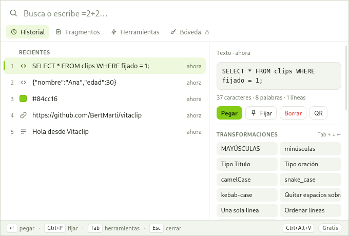

# Vitaclip

**El portapapeles supervitaminado.** Todo lo que copias, a un atajo de distancia, con herramientas para transformarlo antes de pegarlo.

[](https://github.com/BertMarti/vitaclip/actions/workflows/ci.yml)
[](https://github.com/BertMarti/vitaclip/releases/latest)
[](LICENSE)

Vitaclip guarda lo que copias (textos e imágenes) y lo abre en una ventanita con el atajo de teclado que tú elijas. Escribes para buscar,
pulsas Enter y se pega donde estabas. Por el camino puedes pasarlo a mayúsculas, formatear un JSON, calcular, generar una contraseña,
sacar un QR… sin tocar el ratón. Funciona en **Windows, macOS y Linux**, es gratis y todo se queda en tu equipo.



## Descargar

Última versión: **[github.com/BertMarti/vitaclip/releases/latest](https://github.com/BertMarti/vitaclip/releases/latest)**

| Sistema | Archivo |
|---|---|
| Windows 10/11 | `Vitaclip_x.y.z_x64-setup.exe` o `.msi` |
| macOS (Apple Silicon) | `Vitaclip_x.y.z_aarch64.dmg` |
| macOS (Intel) | `Vitaclip_x.y.z_x64.dmg` |
| Linux x64 | `.AppImage`, `.deb` o `.rpm` (`amd64` / `x86_64`) |
| Linux ARM64 (Raspberry Pi 5…) | `.AppImage`, `.deb` o `.rpm` (`arm64` / `aarch64`) |

La app no está firmada (los certificados de Apple y Microsoft son de pago), así que la primera vez el sistema avisa.
Cómo abrirla igualmente, paso a paso: **[docs/INSTALACION.md](docs/INSTALACION.md)**.

## Cómo se usa en 30 segundos

1. La primera vez se abren los ajustes: **graba el atajo que quieras** (cualquier tecla con Ctrl/Cmd, Alt o Shift). Hasta que lo cambies
   vale la sugerencia `Ctrl+Alt+V` (`⌘⌥V` en Mac).
2. Copia cosas como siempre. Vitaclip las guarda en segundo plano (vive en la bandeja del sistema).
3. Pulsa tu atajo, **escribe para buscar** y pulsa **Enter**: se pega en la aplicación donde estabas.

| Tecla | Qué hace |
|---|---|
| `↑` `↓` | Moverse por la lista |
| `Enter` | Pegar |
| `Ctrl+1…9` | Pegar directamente ese elemento |
| `Tab` | Herramientas del elemento (transformaciones, QR, IA…) |
| `Ctrl+P` | Fijar / soltar |
| `Supr` | Borrar |
| `Alt+1…4` | Historial · Fragmentos · Herramientas · Bóveda |
| `=2*(3+4)` | Calculadora: escribe `=` y una operación |
| `;firma` | Pega el fragmento con esa abreviatura |
| `Esc` | Borrar la búsqueda o cerrar |

Guía completa: **[docs/USO.md](docs/USO.md)**.

## Gratis y Pro

| Función | Gratis | Pro |
|---|:---:|:---:|
| Historial de textos e imágenes con búsqueda (`img:`, `url:`, `fij:`) | 300 entradas | hasta 10 000 |
| Fijados y pegado con Enter / `Ctrl+1…9` | ✓ | ✓ |
| Fragmentos con variables (`{fecha}`, `{hora}`, `{portapapeles}`, `{uuid}`, `{cursor}`…) | ✓ | ✓ |
| 22 transformaciones de texto + contador | ✓ | ✓ |
| Calculadora, generadores (UUID, contraseña, fecha, lorem), colores y QR | ✓ | ✓ |
| Atajo personalizable, tema claro/oscuro, español e inglés | ✓ | ✓ |
| **IA en el portapapeles**: traducir, resumir, corregir, reescribir, explicar código | — | ✓ |
| **Bóveda cifrada** para contraseñas y datos sensibles | — | ✓ |
| **Acciones personalizadas** (buscar y reemplazar con regex, cadenas de pasos) | — | ✓ |
| **Plantillas con campos** (`{campo:Nombre}`) | — | ✓ |
| Imágenes grandes (hasta 20 MB) | 3 MB | ✓ |

### Conseguir Pro
Todavía no hay tienda: si quieres una licencia, [abre un issue](https://github.com/BertMarti/vitaclip/issues/new?title=Licencia%20Pro)
o escribe por GitHub. La licencia se pega en **Ajustes → Licencia** y se comprueba sin conexión: no hay cuentas ni servidores.

## Privacidad
- Todo se guarda **solo en tu equipo** (una base de datos SQLite en tu carpeta de usuario). Sin telemetría, sin cuentas, sin anuncios.
- Por defecto **no se guardan** números de tarjeta ni tokens con pinta de clave (`ghp_…`, `sk-…`, `AKIA…`). Puedes añadir tus patrones.
- Puedes **pausar la captura** desde la bandeja o los ajustes.
- La IA (Pro) solo se usa si tú la configuras, con tu Ollama local o con tu clave. Lo que pegas desde la bóveda nunca entra en el historial.

## Compilar desde el código

Requisitos: [Rust](https://rustup.rs) estable, Node.js 20 y las [dependencias de Tauri](https://v2.tauri.app/start/prerequisites/)
de tu sistema (en Debian/Ubuntu: `libwebkit2gtk-4.1-dev libayatana-appindicator3-dev librsvg2-dev libxdo-dev build-essential`).

```bash
git clone https://github.com/BertMarti/vitaclip.git
cd vitaclip
npm install
npm run dev          # abre la app en modo desarrollo
npm run build        # instaladores en src-tauri/target/release/bundle/
npm test             # pruebas de la interfaz
cd src-tauri && cargo test
```

¿Quieres colaborar? Lee [CONTRIBUTING.md](CONTRIBUTING.md).

## Licencia
[Elastic License 2.0](LICENSE). Puedes usar Vitaclip gratis, leer su código y modificarlo. No puedes ofrecerlo como servicio a terceros
ni quitar o esquivar la comprobación de la licencia Pro.
